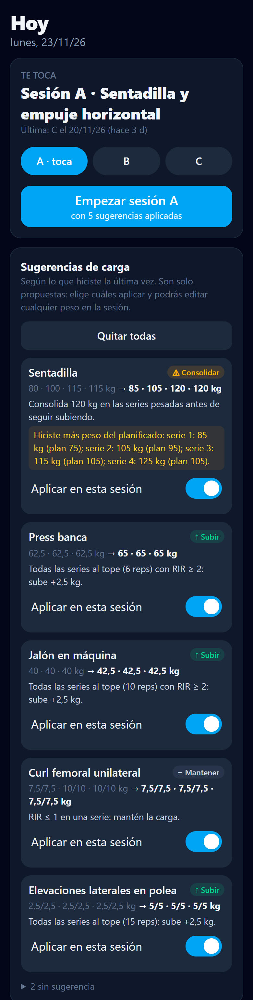
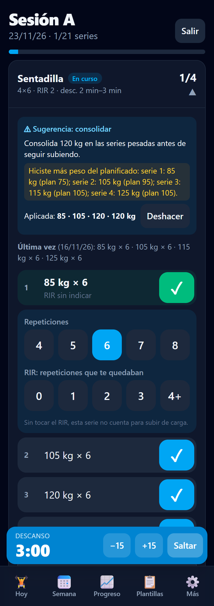
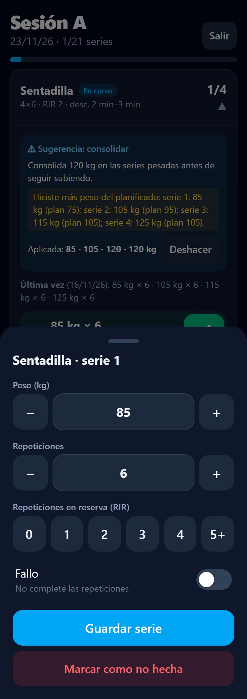
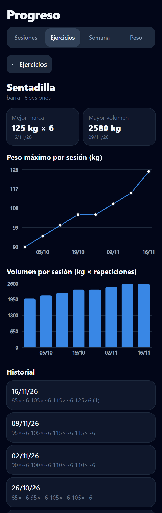
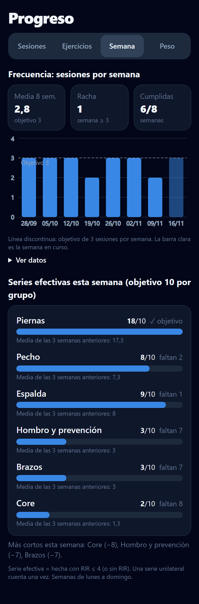
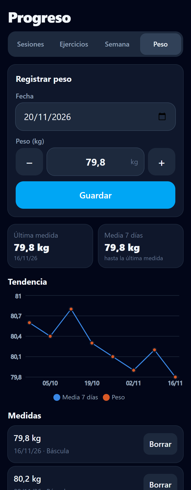

# Gym Tracker

**PWA móvil, offline-first, para registrar y planificar entrenamientos de musculación.**
Pensada para usarse con una mano, en el gimnasio y con mala cobertura: cada toque se guarda al instante en el dispositivo y la app funciona sin conexión.

**Demo:** https://gym-tracker-sooty-three.vercel.app (ábrela en el móvil y añádela a la pantalla de inicio)

> Interfaz en español de España · pesos en kg con coma decimal (`62,5`) · fechas `dd/mm/aa` · modo claro y oscuro.

<p align="center">
  
  
  
</p>
<p align="center">
  
  
  
</p>

<sub>Las capturas usan datos inventados.</sub>

## Qué problema resuelve

Registrar series en el móvil entre serie y serie suele ser lento y propenso a errores. Aquí el objetivo es que **registrar una serie cueste 2–3 toques**:

1. La sesión que toca se abre con todo precargado (objetivo del plan y lo hecho la última vez).
2. Un toque en ✓ guarda la serie (repeticiones de la última vez en esa serie, o el máximo del rango) y arranca el temporizador de descanso.
3. Durante el descanso aparecen, justo debajo, botones grandes de repeticiones y RIR: un toque corrige y, si no se toca nada, la serie se queda como está. Un RIR sin indicar **no cuenta** para subir de carga.
4. Para algo más complejo (peso, fallo, repeticiones por lado), se toca la fila y se abre el editor.

## Funcionalidades

| Fase | Contenido | Estado |
|---|---|---|
| 1 | Catálogo de ejercicios, plantillas A/B/C, registro en el gimnasio, importación de historial | ✅ |
| 2 | Historial por ejercicio, gráficas (Recharts), volumen semanal por grupo muscular, frecuencia y racha, peso corporal | ✅ |
| 3 | Progresión doble automática (sugerencias siempre editables) | ✅ |
| 4 | Calendario de partidos con importancia y ajuste semanal de la sesión (✅); sesión de readaptación tras un parón (⏳) | ⏳ |
| 5 | Exportar JSON/CSV y resumen de las últimas semanas para pegar en un chat | ⏳ |

Ya disponible (fases 1 a 3):

- **Catálogo** por grupo muscular y tipo de carga, con ejercicios unilaterales, excluidos y alias.
- **Plantillas versionables** con series, rango de repeticiones, peso objetivo *por serie*, descanso, RIR y notas; duplicables como nueva versión.
- **Accesorios anidados** bajo su ejercicio principal ("durante los descansos").
- **Cargas distintas por lado** en unilaterales (izquierda siempre primero), sin forzar simetría.
- **Variantes como ejercicios distintos:** si se cambia de máquina, se registra aparte y no se compara con el original.
- **Resumen al cerrar** la sesión, resaltando los accesorios que se han quedado sin hacer.
- **Temporizador de descanso** robusto ante iOS (ver abajo).
- **Progresión doble automática:** al preparar la sesión se proponen cargas según la última vez *en el mismo tipo de sesión*. Siempre son sugerencias: se aplican con un toque (o se deshacen) y cualquier peso se puede editar. Ver reglas más abajo.
- **Progreso por ejercicio:** mejor marca (por lado en unilaterales), peso máximo y volumen por sesión, e historial completo. Las variantes nunca se mezclan.
- **Frecuencia y racha:** sesiones por semana (últimas 8) frente al objetivo, y semanas seguidas cumpliéndolo.
- **Volumen semanal por grupo muscular** en series efectivas frente a un objetivo configurable, señalando qué grupo se queda corto.
- **Peso corporal** con media móvil de 7 días sobre un eje de tiempo real (sin IMC ni "peso ideal").
- **Importador de historial** en JSON con normalización de nombres al catálogo y extracción de repeticiones y RIR desde texto libre.

## Stack

React 19 · TypeScript · Vite · Tailwind CSS 4 · Dexie (IndexedDB) · Recharts · vite-plugin-pwa (Workbox) · Vitest.

## Cómo está planteada

### Lógica pura y testeada
Todo lo que decide algo vive en `src/domain/` como **funciones puras**, sin acceso a base de datos ni a React: formato es-ES, qué sesión toca, resumen de sesión, importación y normalización. Se prueban con Vitest. La capa de datos tiene además tests de integración sobre IndexedDB simulada (`fake-indexeddb`) que recorren el flujo completo: empezar sesión → registrar series → cerrar → sustituir → duplicar plantilla → importar.

### Offline-first
- **Actualizaciones sin sorpresas:** la versión nueva se descarga en segundo plano pero no se activa sola; aparece un aviso «Hay una versión nueva — Actualizar» y los datos y la sesión en curso se conservan. La versión y la fecha de despliegue se ven en *Más*.
- Datos locales en IndexedDB mediante Dexie; **cada toque se escribe al momento**.
- Service worker con precaché de la app (instalable como PWA).
- El temporizador de descanso guarda la **hora de fin**, no un contador: si iOS pausa la app en segundo plano, el tiempo restante sigue siendo correcto al volver.
- Pantalla encendida durante la sesión (Wake Lock) cuando el navegador lo permite.

### Preparada para sincronizar (Supabase)
Todas las entidades son *sync-ready* desde el primer día: `id` UUID generado en cliente, `createdAt`/`updatedAt`, borrado lógico (`deletedAt`) y `deviceId`. La interfaz solo habla con un repositorio (`src/db/repo.ts`), de modo que añadir sincronización con la nube sería escribir una capa sobre él, **sin cambiar el esquema ni la UI**.

### Progresión automática (reglas)
Lógica pura en `src/domain/progression.ts`, con tests de cada regla:
- **Sube** solo si todas las series se hicieron, llegaron al tope del rango de repeticiones, sin fallo y con RIR ≥ 2 (configurable). Barra: +2,5 kg, o +5 kg si fue claramente fácil (RIR medio ≥ 3). Mancuernas y poleas: el siguiente escalón, configurable por tipo de carga y por ejercicio.
- **Mantiene** si hubo fallo, si el RIR fue ≤ 1 en un ejercicio principal, si la sesión quedó incompleta o si aún no se llega al tope del rango.
- **Más peso del planificado:** avisa y propone *consolidar* esa carga en más series antes de seguir subiendo, sin subir además. Ejemplo: planificado 70/90/100/100, hecho 80/100/110/120 con 120×6 a RIR 1 ⇒ próxima sesión 80/100/115/115.
- **Solo decide con datos medidos:** las repeticiones previstas que se importan sin medirse (`~`) nunca cuentan para subir.

### Decisiones de modelo que merece la pena destacar
- Cada ejercicio de una sesión guarda una **copia del plan** vigente (series, rango, objetivos…). Editar una plantilla después **no altera el historial**.
- Sustituir un ejercicio cambia `exerciseId` y conserva el original en `substitutedForExerciseId`; así las comparaciones y la progresión nunca mezclan variantes.
- Las gráficas de línea usan un **eje de tiempo real**, no categórico: con medidas muy espaciadas, una escala por índice falsearía la tendencia. Las gráficas se cargan bajo demanda (*code splitting*) para no penalizar el arranque.
- Los valores importados que no son reales (repeticiones previstas, no medidas) se marcan como `estimated`, para que la futura progresión automática no se fíe de ellos.
- Qué sesión toca sigue la rotación A→B→C **sin acumular** sesiones perdidas.

```
src/
  db/          Esquema Dexie, tipos, datos iniciales y repositorio
  domain/      Lógica pura y testeada (formato, importador, planificación de sesión)
  components/  UI reutilizable (hoja inferior, campos numéricos, temporizador, tarjeta de ejercicio)
  pages/       Pantallas (Hoy, Sesión, Resumen, Progreso, Plantillas, Catálogo, Más)
```

## Ejecutarla

Requiere Node 20 o superior.

```bash
npm install
npm run dev        # http://localhost:5173 (y por Wi-Fi gracias a --host)
npm test           # Vitest
npm run build      # typecheck + build de producción con PWA
npm run icons      # regenera los iconos de la PWA
```

### Probarla en el móvil durante el desarrollo
1. Móvil y ordenador en la misma red Wi-Fi.
2. `npm run dev` y abre en el móvil la URL `Network` que muestra Vite (`http://192.168.x.x:5173`).
3. Por ser `http`, el service worker y la instalación no funcionan en este modo; el resto (IndexedDB incluido) sí.

### Instalarla como PWA
Despliega en un host con HTTPS (por ejemplo Vercel, preset *Vite*; el router usa `HashRouter`, así que no hacen falta reescrituras). En iPhone: Safari → Compartir → **Añadir a pantalla de inicio**.

## Privacidad

Los datos viven **solo en el dispositivo** (IndexedDB); no hay servidor ni analítica. Los archivos de entrenamiento personales para importar no se versionan (`data/` está en `.gitignore`).

## Licencia

[MIT](LICENSE) © 2026 Alessandro Biliato
